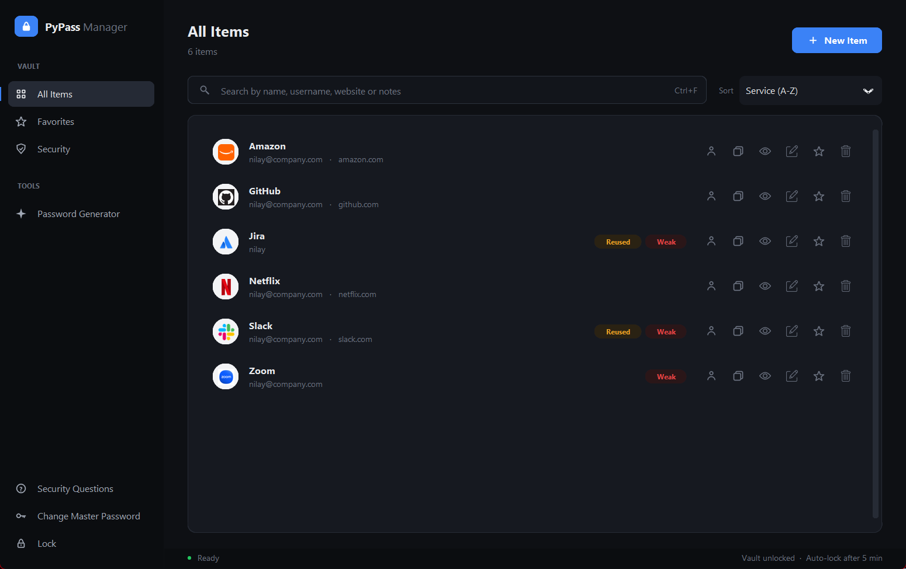
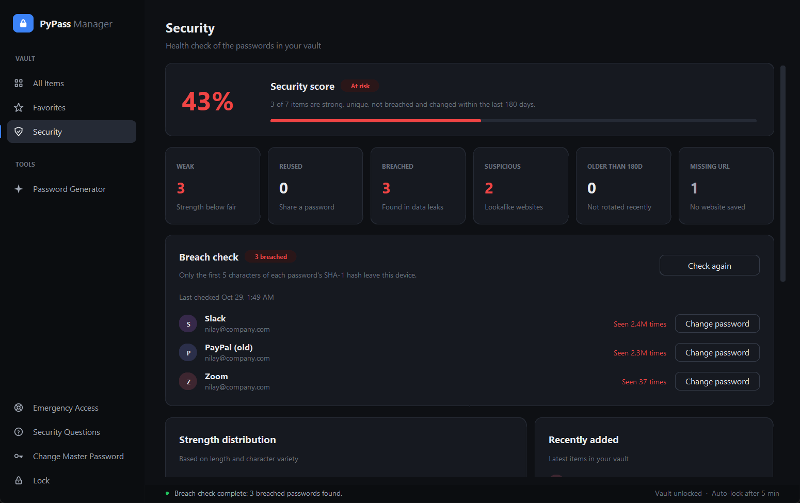
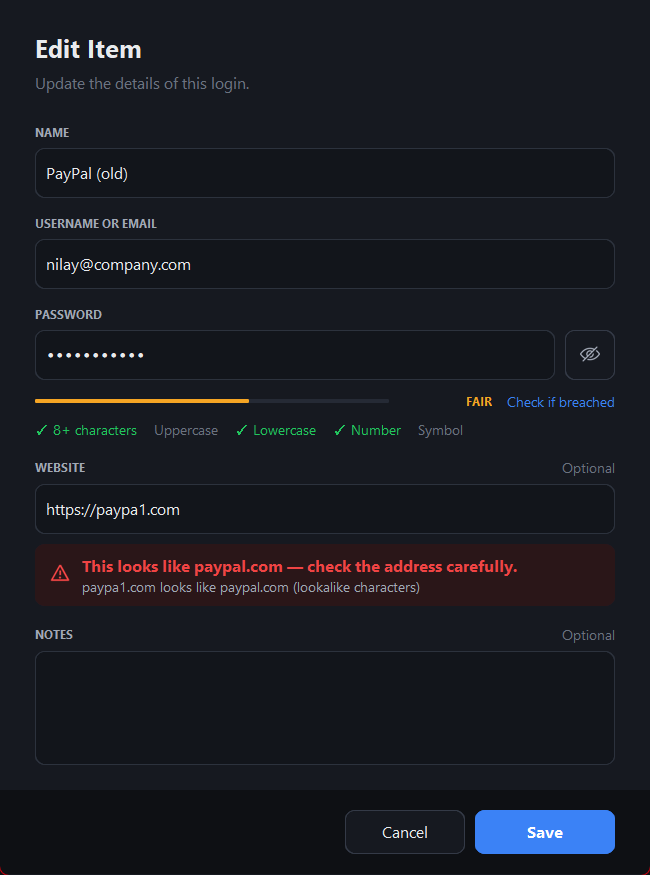
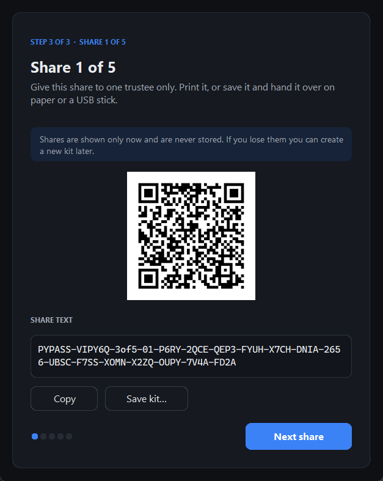
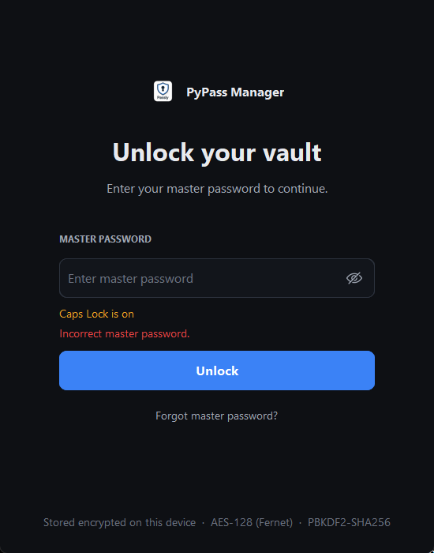
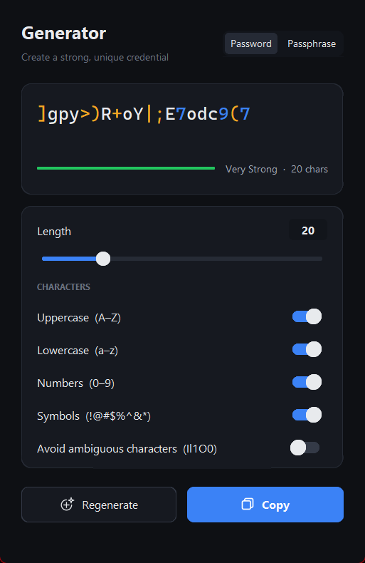

# PyPass Manager

[](https://github.com/AmiNilay/PyPass-Manager/actions/workflows/ci.yml)
[](https://github.com/AmiNilay/PyPass-Manager/releases/latest)

A local-first, offline password manager for Windows, built with Python and CustomTkinter.
Your vault never leaves your computer, and there is no account, cloud or subscription.

It covers what you'd expect from a modern password manager, plus three security features
that most free password managers don't offer: **breach detection**, a **phishing lookalike guard**
and **cryptographic emergency access** (Shamir's Secret Sharing).



---

## Features

### Core
- **Encrypted vault.** All passwords and notes are encrypted with a random vault key (Fernet: AES-128-CBC + HMAC-SHA256).
- **Master password** with PBKDF2-SHA256 key derivation (480,000 iterations), and lockout with exponential backoff after repeated failures.
- **Change or recover your master password without losing data.** The vault key is re-wrapped and credentials are never re-encrypted.
- **Security-question recovery.** Answers ignore capitals and extra spaces.
- **Auto-lock** after 5 minutes of inactivity. While locked, the window is hidden and the key and decrypted data are wiped from memory.
- **Clipboard auto-clear** after 15 seconds. It only clears if the clipboard still holds what the app copied.
- **Password generator** with a length slider from 8 to 64, character options, an "avoid ambiguous characters" option and a passphrase mode. All randomness comes from `secrets`.
- **Website logos** for every item. If no URL is saved, the logo is matched from the service name ("Amazon" → amazon.com). Logos are cached on disk.
- **Search** across name, username, website and encrypted notes, with sorting and favorites.

### Security dashboard
- **Security score**: the share of items that are strong, unique, not breached and changed within the last 180 days.
- Counts of weak, reused, breached, suspicious, old and missing-URL items, with one-click recommendations.



### 🔓 Breach check (Have I Been Pwned)
Checks every password against more than 900 million leaked passwords using the
[Pwned Passwords](https://haveibeenpwned.com/API/v3#PwnedPasswords) k-anonymity API.
**Only the first 5 characters of each password's SHA-1 hash leave your computer.** The password and its full hash are never sent.
The check runs only when you click the button.

### 🎣 Phishing lookalike guard
Warns you when a saved website imitates a real one. It works fully offline and catches:
- lookalike characters: `paypa1.com`, `rnicrosoft.com`, `faceb00k.com`
- Unicode homographs: a Cyrillic `а` inside `pаypal.com`
- typosquats: `gooogle.com`
- brand-in-subdomain tricks: `paypal.secure-login.com`
- combosquats: `paypal-verify.com`, `netflix-billing.net`
- TLD swaps: `paypal.co`
- near-copies of other sites already saved in your vault



### 🛟 Emergency Access (Shamir's Secret Sharing)
Choose N trusted people and a threshold K (for example 3 of 5). The app splits a recovery secret
into N shares using Shamir's Secret Sharing over GF(256), and gives each person a QR code and a printable kit.
**Any K of them together can unlock your vault. Fewer than K learn nothing.** The shares are never stored by the app.
Recovery is done from the login screen with **"Use emergency kit"**.



| Login | Generator |
|---|---|
|  |  |

---

## Install (Windows)

Download `PyPass-Manager-Setup-x.y.z.exe` from the [Releases](https://github.com/AmiNilay/PyPass-Manager/releases)
page and run it. No admin rights are needed. Your vault is stored in `%USERPROFILE%\.pypass_manager`
and is kept when you uninstall or upgrade.

> Windows SmartScreen may warn about an unrecognised app because the installer isn't code-signed.
> Click **More info → Run anyway**.

## Run from source

Requires Python 3.11 or newer.

```bash
git clone https://github.com/AmiNilay/PyPass-Manager.git
cd PyPass-Manager
python -m venv .venv
.venv\Scripts\activate
pip install -r requirements.txt
python main.py
```

## Run the tests

```bash
pip install -r requirements-dev.txt
python -m pytest -q tests
```

There are more than 120 tests covering the vault cryptography, migrations, lockout, Shamir sharing, emergency recovery,
the breach check (network mocked) and phishing detection. To also hit the live HIBP API, set `PYPASS_NETWORK_TESTS=1`.

## Build the Windows installer

1. **Build the app** with PyInstaller:
   ```bash
   pip install -r requirements-dev.txt
   python -m PyInstaller --noconfirm "PyPass Manager.spec"
   ```
   This creates `dist\PyPass Manager\PyPass Manager.exe`, a portable folder you could zip and share as is.
2. **Install [Inno Setup 6](https://jrsoftware.org/isdl.php)**, which is free.
3. **Compile the installer:**
   ```bash
   "C:\Program Files (x86)\Inno Setup 6\ISCC.exe" installer\PyPassManager.iss
   ```
   This creates `installer\Output\PyPass-Manager-Setup-2.0.0.exe`, a single-file installer with Start-menu and desktop shortcuts and an uninstaller.
4. **Publish it.** Create a GitHub Release (for example tag `v2.0.0`) and attach the setup `.exe`.

### Automated releases (GitHub Actions)

Every push and pull request runs the test suite ([ci.yml](.github/workflows/ci.yml)).
To publish a release, bump the version and push a tag. [release.yml](.github/workflows/release.yml) then runs
the tests, builds the app and the installer, and publishes a GitHub Release with
`PyPass-Manager-Setup-x.y.z.exe` and a portable `.zip`:

```bash
# 1. set APP_VERSION = "2.0.1" in config/settings.py (and the numbers in version_info.txt)
git commit -am "Release 2.0.1"
git tag v2.0.1
git push origin main v2.0.1
```

The workflow stops if the tag doesn't match `APP_VERSION`.

---

## How the security works

```
master password ──PBKDF2──► key-encryption key ──unwraps──┐
security answers ─PBKDF2──► recovery key ─────unwraps──┤
K-of-N Shamir shares ──────► emergency key ───unwraps──┼──► vault key ──Fernet──► passwords & notes
```

- One random **vault key** encrypts all data. It is stored three times, each copy wrapped by a different key.
  That's why changing or recovering the master password never re-encrypts or loses your data.
- The master password is verified against a separate PBKDF2 hash. Failed attempts trigger a lockout
  (5 free attempts, then 30 s doubling up to 15 min), which survives restarts.
- Network access is limited to two features:
  - **Website logos:** only the domain is sent. Set `FETCH_FAVICONS = False` in `config/settings.py` to turn them off.
  - **Breach check:** only a 5-character hash prefix is sent, and only on demand.
- **Not encrypted:** service names, usernames and URLs are stored in plain text so they can be searched and sorted.
  Anyone with access to your user profile can read *which* sites you have accounts on, but not the passwords or notes.

## Project structure

```
app/
  core/        crypto, database, breach check, phishing guard, Shamir sharing, favicons
  ui/          CustomTkinter windows and dialogs (theme.py = design system, widgets.py = shared widgets)
config/        settings
assets/        icons and theme
tests/         pytest suite
installer/     Inno Setup script
PyPass Manager.spec   PyInstaller build recipe
```

## Roadmap

- Import and export (Chrome, Bitwarden, 1Password CSV) and encrypted backups
- TOTP (2FA) codes
- Argon2id key derivation
- Windows Hello unlock
